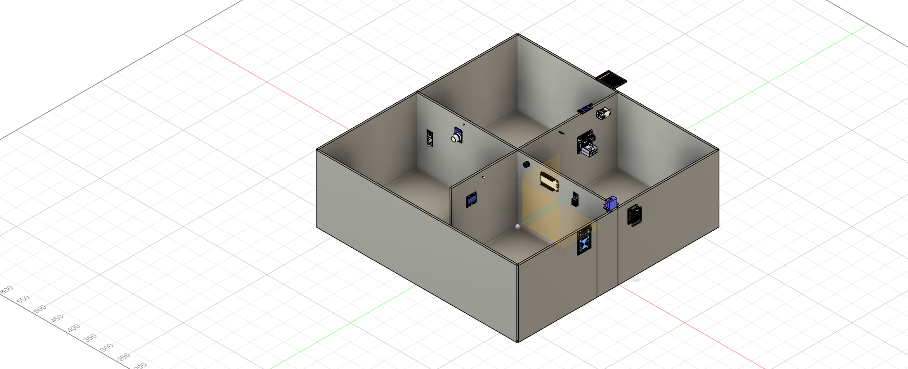
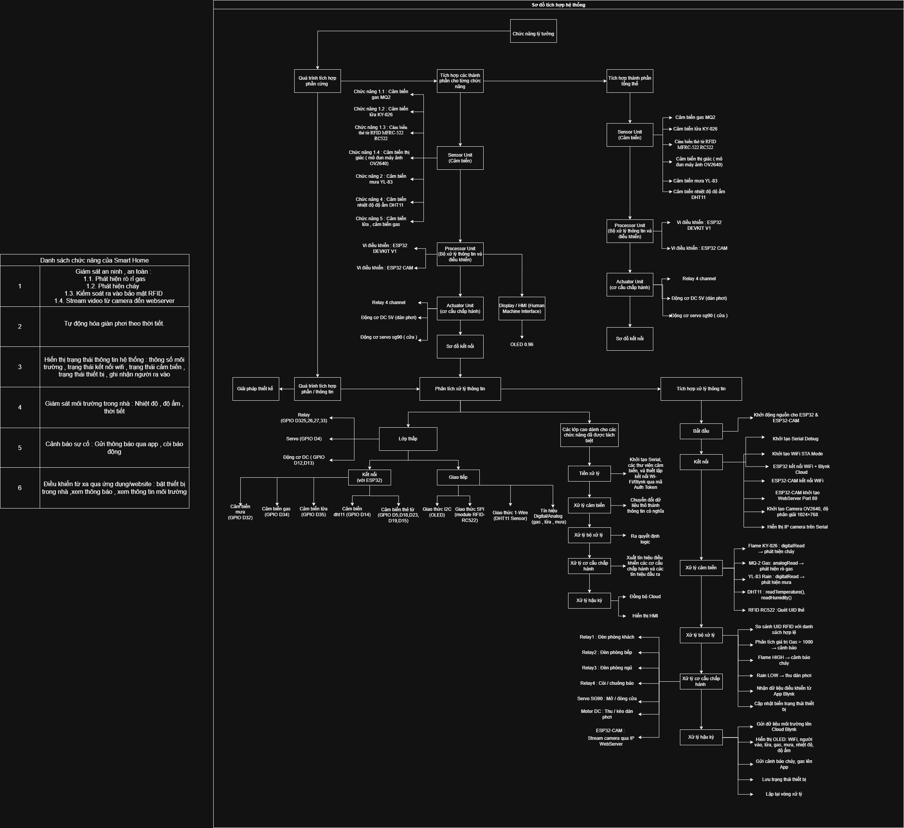
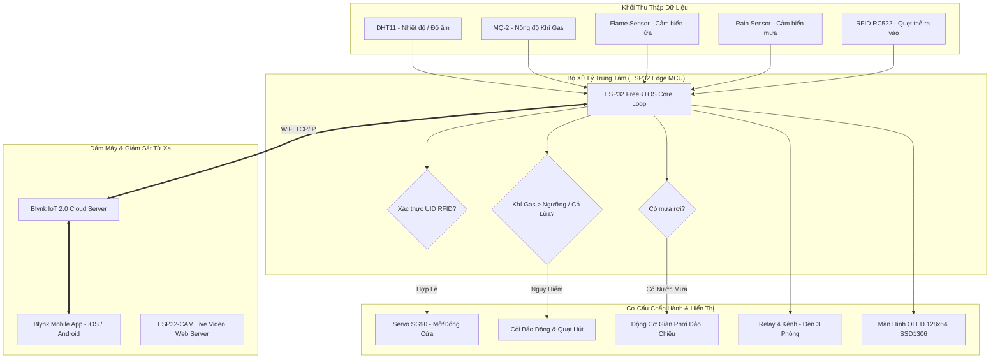
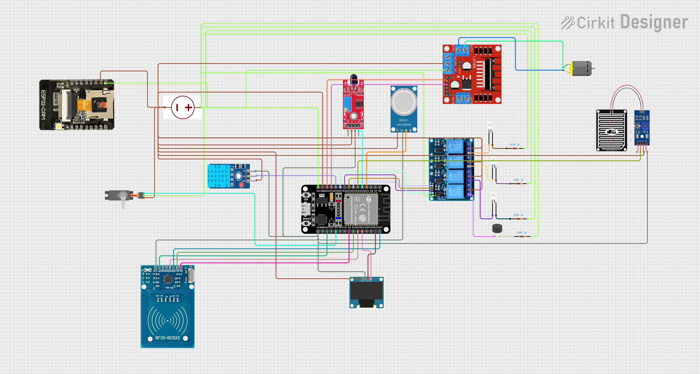
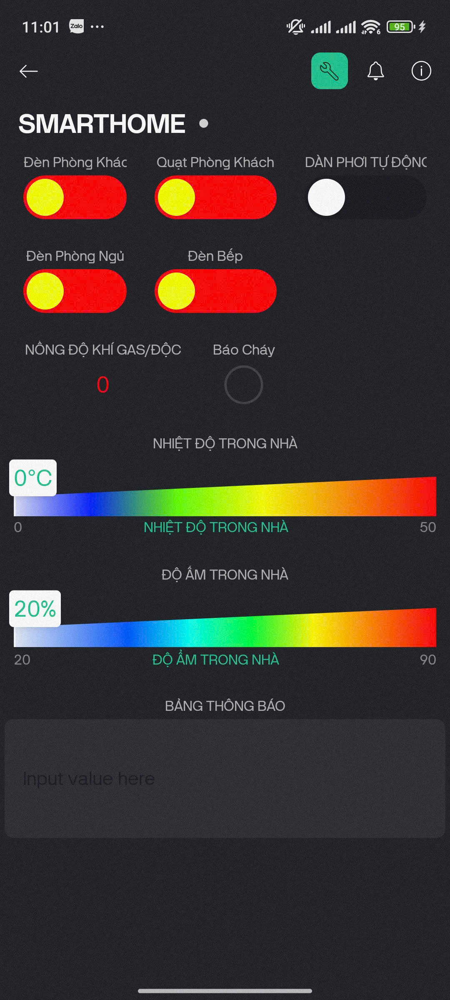

<div align="center">

# 🏠 ESP32 IoT Smart Home & Surveillance System
### *An End-to-End Smart Home Automation, Security & Live Video Surveillance Solution*

[](https://www.espressif.com/)
[](https://www.arduino.cc/)
[](https://blynk.io/)
[](https://opensource.org/licenses/MIT)
[](#)

<p align="center">
  
</p>

[**Khám Phá Tài Liệu**](#-cấu-trúc-thư-mục-repository) • [**Sơ Đồ Kết Nối**](docs/pinout_mapping.md) • [**Hướng Dẫn Cài Đặt**](#-hướng-dẫn-cài-đặt--nạp-firmware) • [**Danh Mục Linh Kiện (BOM)**](hardware/BOM.md) • [**Cấu Hình Blynk**](docs/blynk_setup_guide.md)

</div>

---

## 📖 Tổng Quan Dự Án (Project Overview)

**ESP32 Smart Home System** là mô hình nhà thông minh toàn diện, tích hợp sâu giữa **Cơ điện tử (Mechatronics)**, **Hệ thống nhúng (Embedded Systems)** và **Mạng lưới vạn vật kết nối (IoT)**.

Hệ thống được thiết kế với kiến trúc **Dual-Core Edge Controller**, bao gồm vi điều khiển **ESP32** đóng vai trò Master Controller quản lý toàn bộ cảm biến, cơ cấu chấp hành, màn hình hiển thị OLED và giao tiếp đám mây **Blynk IoT 2.0 Cloud**, kết hợp cùng module **ESP32-CAM AI-Thinker** hoạt động như một Camera giám sát an ninh độc lập phát luồng video trực tiếp (Live MJPEG Video Stream) qua Web Server nội bộ.

---

## 🌟 Tính Năng Nổi Bật (Key Features)

| Phân Hệ | Tính Năng & Chức Năng Chi Tiết | Linh Kiện / Giao Thức |
| :--- | :--- | :--- |
| 🔐 **Kiểm Soát Ra Vào (Smart Access)** | Quẹt thẻ từ bảo mật mở cửa, tự động mở servo và tự khóa sau 3 giây. Cảnh báo thẻ lạ lên OLED. | RFID-RC522 (SPI) + Servo SG90 |
| 🔥 **Cảnh Báo Cháy & Khí Gas (Safety Alarm)** | Phát hiện sớm ngọn lửa & rò rỉ khí gas hóa lỏng. Tự động hú còi báo động khẩn cấp, bật quạt hút và gửi cảnh báo về điện thoại. | MQ-2 (ADC) + Flame Sensor + Buzzer/Fan |
| 🌦️ **Giàn Phơi Thông Minh (Smart Clothesline)** | Tự động kéo giàn phơi ra khi trời nắng ráo và tự động thu vào khi phát hiện hạt mưa đầu tiên. | Rain Sensor (Digital) + DC Motor H-Bridge |
| 🌡️ **Giám Sát Môi Trường (Environment)** | Đo nhiệt độ và độ ẩm thời gian thực, hiển thị trực quan lên màn hình OLED và đồng bộ lên biểu đồ đám mây. | DHT11 + OLED 0.96" SSD1306 (I2C) |
| 💡 **Chiếu Sáng Thông Minh (Multi-Room Lighting)** | Điều khiển bật/tắt độc lập đèn phòng khách, phòng bếp, phòng ngủ từ bất cứ đâu thông qua ứng dụng di động. | Relay 4-Channel (Opto-isolated) + Blynk App |
| 📹 **Camera An Ninh Trực Tuyến (Surveillance)** | Truyền hình ảnh video thời gian thực từ camera quan sát lên Web Browser cục bộ độ phân giải HD. | ESP32-CAM (OV2640) + HTTP Streaming |

---

## 🏗️ Kiến Trúc Hệ Thống (System Architecture)

<div align="center">
  
</div>

### Luồng Hoạt Động (Data & Control Flow):



---

## ⚡ Sơ Đồ Đấu Nối Phần Cứng (Wiring & Schematics)

<div align="center">
  
</div>

### Bảng Tóm Tắt Chân GPIO (ESP32 Master):

| Chân ESP32 | Linh Kiện Ngoại Vi | Chức Năng / Giao Tiếp |
| :---: | :--- | :--- |
| **GPIO 14** | DHT11 Sensor | Đọc dữ liệu nhiệt độ và độ ẩm (1-Wire) |
| **GPIO 35** | Flame Sensor | Tín hiệu số phát hiện lửa (Digital Input) |
| **GPIO 34** | MQ-2 Gas Sensor | Điện áp nồng độ gas (Analog ADC1) |
| **GPIO 32** | Rain Sensor | Tín hiệu phát hiện nước mưa (Digital Input) |
| **GPIO 5, 15, 18, 19, 23** | MFRC522 RFID | Chuẩn giao tiếp SPI (SS, RST, SCK, MISO, MOSI) |
| **GPIO 4** | Servo SG90 | Tín hiệu PWM điều khiển góc mở cửa |
| **GPIO 13, 12** | Động cơ DC Giàn phơi | Điều khiển mạch cầu H đảo chiều động cơ |
| **GPIO 33, 25, 26, 27** | Module Relay 4 Kênh | Điều khiển 3 line đèn và 1 line Còi/Quạt (Active LOW) |
| **GPIO 21, 22** | Màn hình OLED SSD1306 | Chuẩn giao tiếp I2C (SDA, SCL) |

👉 *Xem chi tiết tại: [docs/pinout_mapping.md](docs/pinout_mapping.md)*

---

## 📱 Giao Diện Điều Khiển Blynk IoT

<div align="center">
  
</div>

- **V0 - V2**: Bật/Tắt độc lập đèn phòng khách, phòng bếp, phòng ngủ.
- **V3**: Điều khiển còi báo động và quạt hút khẩn cấp.
- **V4 - V5**: Giám sát nồng độ khí Gas và trạng thái cảm biến lửa.
- **V6 - V7**: Đồng hồ hiển thị thời gian thực Nhiệt độ (°C) và Độ ẩm (%).
- **V8**: Trạng thái giàn phơi thông minh (Mưa/Tạnh).
- **V10**: Gửi thông điệp văn bản từ xa hiển thị trực tiếp lên màn hình OLED.

👉 *Xem chi tiết cấu hình tại: [docs/blynk_setup_guide.md](docs/blynk_setup_guide.md)*

---

## 📂 Cấu Trúc Thư Mục Repository

```
ESP32-SmartHome-IoT-System/
├── .github/
│   └── workflows/
│       └── build-check.yml            # CI Workflow kiểm tra tính toàn vẹn codebase
├── assets/
│   └── images/                        # Hình ảnh sơ đồ, giao diện app, mô hình 3D
├── docs/
│   ├── flowcharts/                    # Lưu đồ thuật toán chi tiết các chức năng
│   ├── blynk_setup_guide.md           # Hướng dẫn thiết lập Blynk Datastreams & Widgets
│   ├── pinout_mapping.md              # Bảng phân bổ chân GPIO & sơ đồ nguyên lý
│   └── system_architecture.md         # Phân tích kiến trúc hệ thống chuyên sâu
├── firmware/
│   ├── esp32_main/                    # Firmware chính cho ESP32 Master
│   │   ├── esp32_main.ino
│   │   └── config.example.h           # Template cấu hình WiFi, Blynk, RFID UID
│   └── esp32_cam/                     # Firmware Web Video Streamer cho ESP32-CAM
│       ├── esp32_cam.ino
│       └── config.example.h
├── hardware/
│   ├── 3d_models/
│   │   ├── SMARTHOME3D.stl            # File CAD 3D STL mô hình nhà thông minh
│   │   └── SMARTHOME3D.png
│   ├── schematics/                    # Sơ đồ mạch nguyên lý (Modular & Complete)
│   └── BOM.md                         # Bảng kê linh kiện chi tiết (Bill of Materials)
├── .gitignore
├── CONTRIBUTING.md
├── LICENSE
└── README.md
```

---

## 🚀 Hướng Dẫn Cài Đặt & Nạp Firmware

### 1. Chuẩn Bị Môi Trường
- Cài đặt **[Arduino IDE](https://www.arduino.cc/en/software)** (hoặc **PlatformIO** trên VS Code).
- Cài đặt ESP32 Board Package trong Arduino IDE:
  `Preferences -> Additional Board Manager URLs -> Thêm link:`
  `https://raw.githubusercontent.com/espressif/arduino-esp32/gh-pages/package_esp32_index.json`
- Cài đặt các thư viện cần thiết qua *Library Manager*:
  - `Blynk` by Volodymyr Shymanskyy
  - `DHT sensor library` by Adafruit
  - `Adafruit SSD1306` & `Adafruit GFX Library`
  - `MFRC522` by GithubCommunity
  - `ESP32Servo` by Kevin Harrington
  - `esp32cam` by yoursunny (cho module camera)

### 2. Cấu Hình & Nạp Code ESP32 Master
1. Mở file [`firmware/esp32_main/esp32_main.ino`](firmware/esp32_main/esp32_main.ino).
2. Điền thông tin WiFi (`ssid`, `pass`) và mã `BLYNK_AUTH_TOKEN` của bạn.
3. Cập nhật mã thẻ RFID của bạn vào mảng `allowedUIDs[]`.
4. Chọn Board: **ESP32 Dev Module**, chọn đúng Cổng COM và bấm **Upload**.

### 3. Cấu Hình & Nạp Code ESP32-CAM
1. Mở file [`firmware/esp32_cam/esp32_cam.ino`](firmware/esp32_cam/esp32_cam.ino).
2. Nối chân **GPIO 0** vào **GND** trên ESP32-CAM để vào chế độ nạp flash.
3. Chọn Board: **AI Thinker ESP32-CAM**, cấu hình tần số Flash 80MHz.
4. Nạp code xong, **rút chân GPIO 0 khỏi GND** và nhấn nút **RESET**.
5. Mở Serial Monitor (115200 baud) để lấy địa chỉ IP Web Server và truy cập từ trình duyệt.

---

## 🛠️ Công Nghệ & Kỹ Năng Ứng Dụng (Skills & Technologies)

- **Ngôn ngữ & Nền tảng**: C/C++, Embedded C, Arduino Framework, FreeRTOS.
- **Giao thức truyền thông**: SPI, I2C, UART, 1-Wire, HTTP/REST, TCP/IP, Wi-Fi 802.11.
- **Nền tảng Cloud / IoT**: Blynk IoT Platform, WebSockets, IP Camera Streaming.
- **Thiết kế & Phần cứng**: SolidWorks / AutoCAD (Thiết kế mô hình 3D STL), Fritzing / EasyEDA (Sơ đồ mạch nguyên lý).

---

## 👤 Tác Giả & Liên Hệ (Author)

**Nguyễn Văn Phú**  
🎓 Sinh viên ngành Kỹ thuật Cơ điện tử (Mechatronics Engineering)  
🏫 Khóa EMA 2027 | Mã sinh viên: `23021322`  
✨ *Dự án đồ án môn học: Nhập môn Cơ điện tử - Đạt đánh giá cao về tính ứng dụng và độ hoàn thiện thực tế.*

---

## 📄 Bản Quyền (License)

Dự án được phân phối dưới giấy phép mã nguồn mở **[MIT License](LICENSE)**.
Mọi người đều có thể tự do tham khảo, học hỏi, chỉnh sửa và ứng dụng cho mục đích cá nhân hoặc nghiên cứu học tập.
