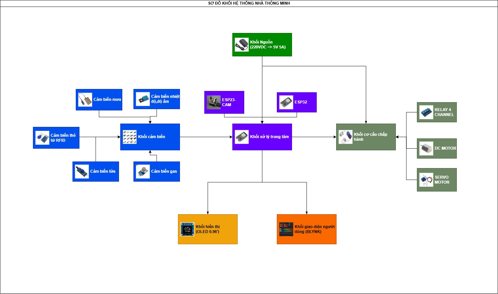
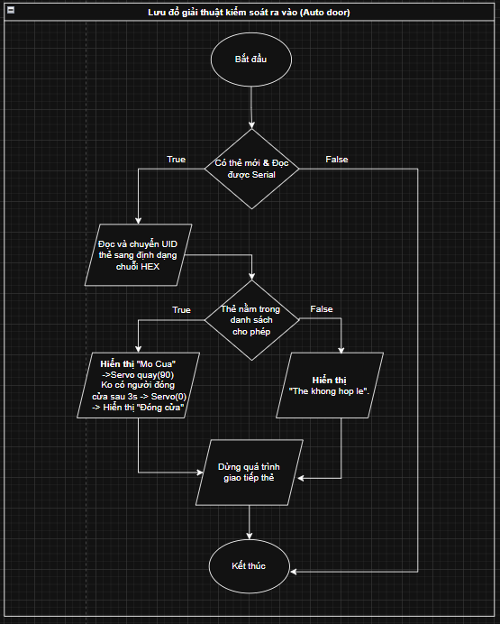
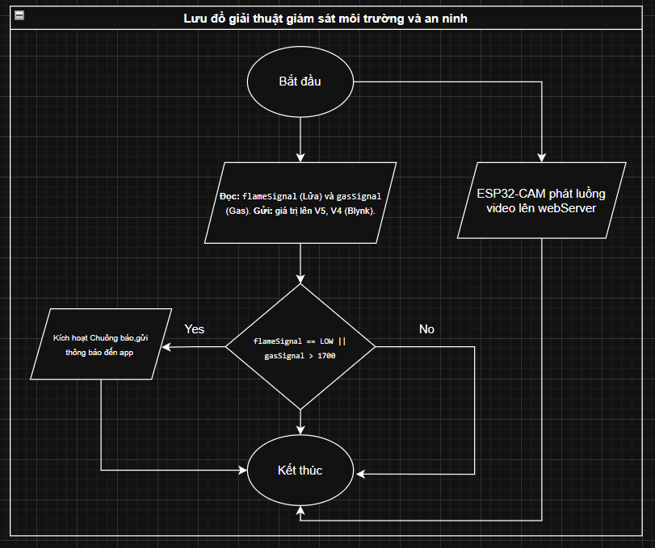
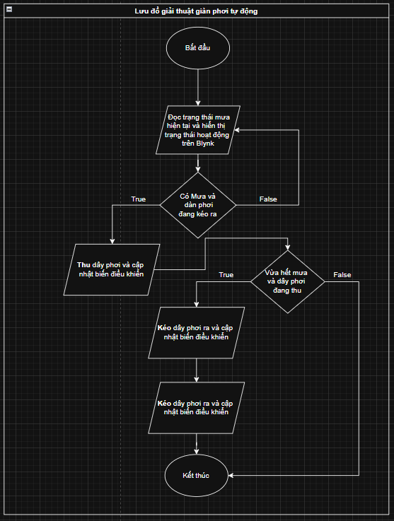
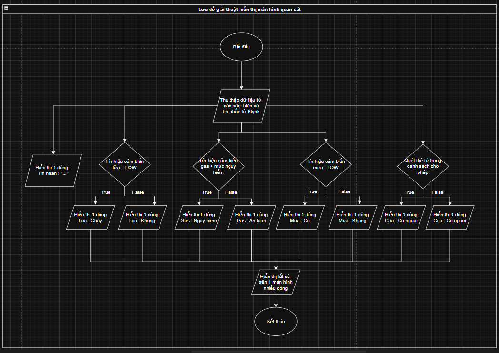

# 🏗️ System Architecture & Engineering Design

Tài liệu mô tả kiến trúc kỹ thuật, luồng xử lý dữ liệu và thiết kế tích hợp hệ thống của **ESP32 Smart Home IoT System**.

---

## 1. Sơ Đồ Khối Tổng Thể (System Block Diagram)



### Phân Tầng Kiến Trúc (Architectural Layers):

```
+-------------------------------------------------------------------------+
|                         APPLICATION & CLOUD LAYER                       |
|     +--------------------------------+  +--------------------------+    |
|     |  Blynk IoT Cloud (iOS/Android) |  |  Web Video Stream Client |    |
|     +--------------------------------+  +--------------------------+    |
+------------------------------------+------------------+-----------------+
                                     | WiFi (TCP/IP)    | WiFi (HTTP/MJPEG)
+------------------------------------+------------------+-----------------+
|                       EDGE PROCESSING & CONTROL                         |
|   +------------------------------------+ +--------------------------+   |
|   |    ESP32 Central Automation MCU    | |  ESP32-CAM Video Stream  |   |
|   |  (FreeRTOS, WiFi, SPI, I2C, GPIO)  | |      (OV2640 Engine)     |   |
|   +-----------------+------------------+ +--------------------------+   |
+---------------------+---------------------------------------------------+
                      |
+---------------------+---------------------------------------------------+
|                        PERIPHERALS & HARDWARE LAYER                     |
|  [SENSORS]           [COMMUNICATION/UI]    [ACTUATORS & LOADS]          |
|  - DHT11 (Temp/Hum)  - OLED SSD1306 (I2C)  - 4-Channel Relays (Lights)  |
|  - MQ-2 (Gas/Smoke)  - MFRC522 RFID (SPI)  - SG90 Servo (Auto Door)     |
|  - Flame Sensor                            - DC Motor (Clothesline)     |
|  - Rain Sensor                             - Active Buzzer (Alarm)      |
+-------------------------------------------------------------------------+
```

---

## 2. Luồng Xử Lý Dữ Liệu & Thuật Toán (Data Flow & Logic)

### 2.1. Kiểm Soát Ra Vào Tự Động (Smart Access Control)
- **Cơ chế**: Module RFID-RC522 quét thẻ định kỳ qua chuẩn giao tiếp SPI tốc độ cao.
- **Xử lý**: Khi nhận được thẻ, mã UID (4-byte HEX) được so khớp với danh sách `ALLOWED_UIDS` trong bộ nhớ Flash.
- **Hành động**:
  - Nếu *Hợp lệ*: Kích hoạt Servo quay 90° để mở cửa, cập nhật màn hình OLED và tự động đóng sau 3 giây.
  - Nếu *Không hợp lệ*: Hiển thị cảnh báo từ chối truy cập lên màn hình OLED.



---

### 2.2. Giám Sát An Ninh & Báo Cháy Khẩn Cấp (Safety & Hazard Protection)
- **Cơ chế**: Quét liên tục ngắt/polling trạng thái của Cảm biến Lửa (GPIO35) và Nồng độ Khí Gas (GPIO34 ADC).
- **Phản ứng**:
  - Khi nồng độ gas vượt ngưỡng (`gasSignal > 1000`) hoặc phát hiện ngọn lửa (`flameSignal == HIGH`), ESP32 ngay lập tức kích hoạt mức LOW vào Relay 4 để hú còi và bật quạt hút khẩn cấp.
  - Dữ liệu sự cố được đẩy thời gian thực lên Blynk Cloud để gửi thông báo cảnh báo tức thì tới người dùng.



---

### 2.3. Giàn Phơi Đồ Thông Minh (Smart Clothesline Automation)
- **Cơ chế**: Cảm biến mưa phát hiện giọt nước ngưng tụ trên bề mặt điện cực.
- **Xử lý**: Khi trời mưa (Tín hiệu LOW), mạch cầu H điều khiển động cơ DC quay theo chiều thu giàn phơi trong 2 giây. Khi trời tạnh mưa, động cơ đảo chiều để đẩy giàn phơi ra ngoài đón nắng.



---

### 2.4. Giám Sát Môi Trường & Hiển Thị Đa Kênh (Environmental Monitoring & Dashboard)
- **Cơ chế**: DHT11 đo chu kỳ nhiệt độ, độ ẩm mỗi 2 giây.
- **Xử lý**: Cập nhật thông số trực quan lên màn hình OLED 0.96" SSD1306 tại phòng khách và gửi đồng bộ qua Virtual Pins V6, V7 lên ứng dụng Blynk IoT.



---

## 3. Hệ Thống Camera Giám Sát Thời Gian Thực (ESP32-CAM Streamer)

Hệ thống sử dụng module **ESP32-CAM AI-Thinker** chạy độc lập với vi điều khiển chính nhằm đảm bảo:
1. **Hiệu năng cao**: Tránh nghẽn tài nguyên CPU khi xử lý đồng thời luồng nén ảnh JPEG/MJPEG và các tác vụ thời gian thực của Smart Home.
2. **Độ ổn định**: Hoạt động độc lập 24/7 như một IP Camera nhỏ gọn, phục vụ truy cập qua trình duyệt web trên máy tính hoặc điện thoại trong cùng mạng LAN.
